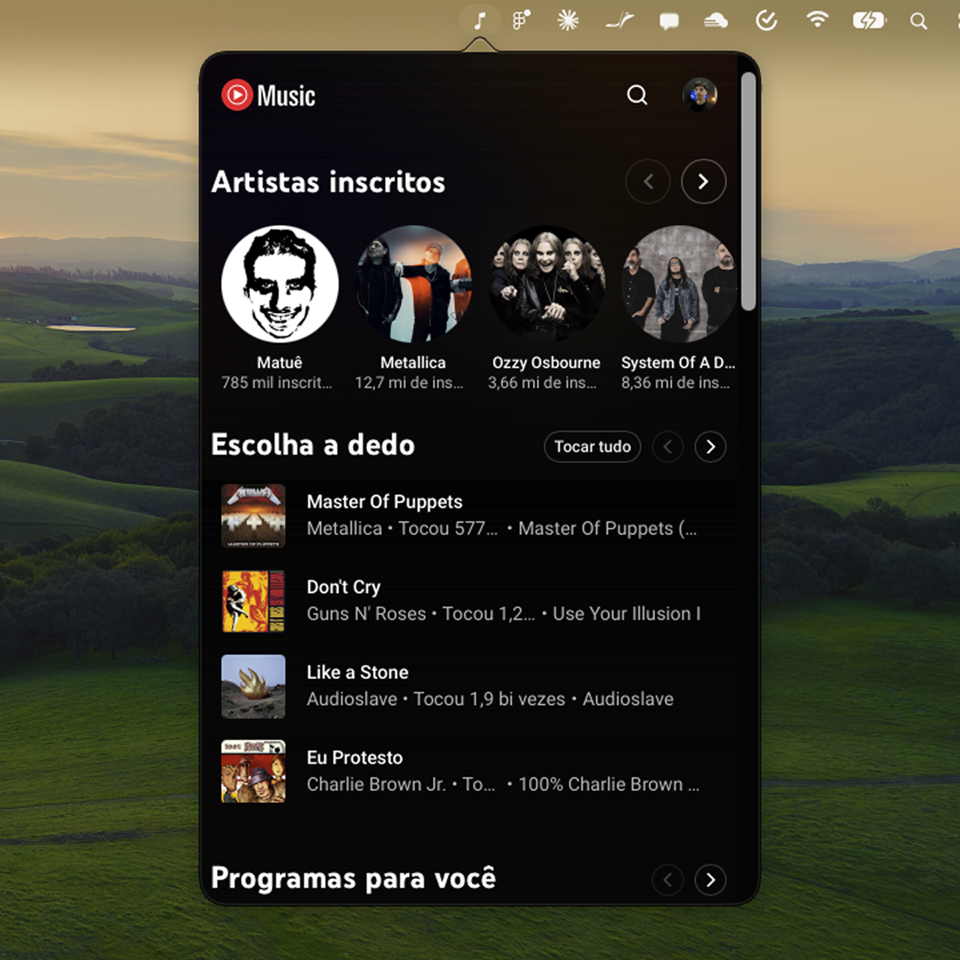
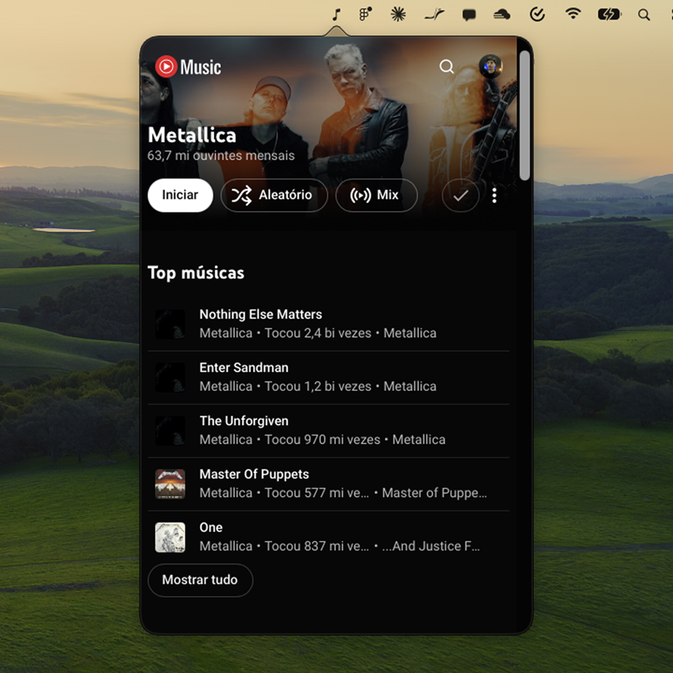
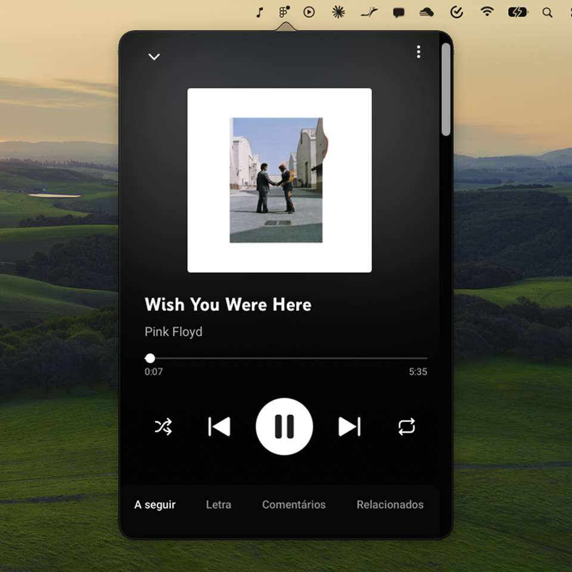

<div align="center">

# YTMusicBar

**YouTube Music in the macOS menu bar, without ads.**


[](LICENSE)
[](https://github.com/CarlosAllberto/ytmusicbar/actions/workflows/build.yml)

[Features](#features) • [Install](#install) • [Usage](#usage) • [How it works](#how-it-works) • [Customize](#customize) • [Limitations](#limitations)

English • <a href="README.pt-BR.md">Português</a>

</div>

YTMusicBar is a native menu bar app that plays [YouTube Music](https://music.youtube.com) in a compact popover. It blocks ads, hides the clutter and keeps the music playing when the popover is closed.

The app loads the official YouTube Music website in a `WKWebView`. Your login is kept between launches.

<p align="center">
  
  
  
</p>

> [!NOTE]
> YTMusicBar is an independent project. It is not affiliated with YouTube or Google.

## Features

- **No ads:** network rules block ad requests and an injected script skips and hides what gets through.
- **Subscribed artists carousel:** the home page starts with the artists you follow, refreshed every time you come back to it.
- **Cleaner interface:** no hamburger menu, mood chips, video shelves or **Baixar** item in the track menus. Text cannot be selected.
- **Quick start:** artist pages and search results get an **Iniciar** button before Aleatório and Mix. Subscribing is a single heart or check icon.
- **Original track order:** shuffle is turned off when a playlist or album starts, and playback stops at the end instead of drifting to suggestions. Toggle it from the menu.
- **Media keys and Now Playing:** play, pause, next and previous work from the keyboard, and the current track shows in the macOS Now Playing widget.
- **Smart reopen:** the popover opens on the player if music is playing, otherwise on the home page.
- **Global shortcut:** <kbd>⌥</kbd> <kbd>S</kbd> opens and closes the popover from any app.
- **Launch at login** and **no Dock icon**.

## Install

### Download the prebuilt app

1. Download `YTMusicBar.zip` from the [latest release](https://github.com/CarlosAllberto/ytmusicbar/releases/latest).
2. Unzip it and move `YTMusicBar.app` to `/Applications`.
3. Remove the quarantine flag and open the app:

```bash
xattr -dr com.apple.quarantine /Applications/YTMusicBar.app
```

Releases are built by GitHub Actions for every `v*` tag.

> [!NOTE]
> The app is ad-hoc signed and not notarized by Apple, so macOS blocks it until you remove the quarantine flag.

### Build from source

Requirements:

- macOS 13 or later
- Xcode 15 or later
- [XcodeGen](https://github.com/yonaskolb/XcodeGen)

```bash
brew install xcodegen
git clone https://github.com/CarlosAllberto/ytmusicbar.git
cd ytmusicbar
xcodegen generate
xcodebuild -project YTMusicBar.xcodeproj -scheme YTMusicBar -configuration Release -derivedDataPath build build
open build/Build/Products/Release/YTMusicBar.app
```

The Xcode project is generated from [`project.yml`](project.yml) and is not committed. Run `xcodegen generate` again whenever you add or remove files.

## Usage

| Action | How |
| --- | --- |
| Open or close the popover | Click the icon or press <kbd>⌥</kbd> <kbd>S</kbd> |
| Open the menu | Right-click the icon |
| Reload the page | Menu, **Recarregar** |
| Keep the original track order | Menu, **Manter ordem das faixas** |
| Launch at login | Menu, **Iniciar com o macOS** |
| Quit | Menu, **Sair** |

The first time, sign in with your Google account inside the popover.

> [!NOTE]
> The app menu is in Portuguese for now. YouTube Music follows your account language.

## How it works

```
YTMusicBar/
├── App/        AppDelegate: status item, popover and menu
├── Views/      Popover content
├── WebView/    Shared WKWebView and ad block rule loading
├── Services/   Media controls, global shortcut (Carbon), settings
└── Resources/  Injected scripts and network rules
```

- **AppKit, not `MenuBarExtra`.** A status item with a popover allows a right-click menu and full control of the WebView. This is also the simplest way to keep the page alive.
- **One WebView that stays alive.** `WebViewHost` creates a single `WKWebView`. When the popover closes, the view moves to a hidden window, so the audio keeps playing. The page loads only after the block rules compile.
- **Three injected scripts** in [`Resources/`](YTMusicBar/Resources):
  - `inject-ads.js` skips ads and removes promotions.
  - `inject-order.js` keeps the original track order.
  - `inject-ui.js` hides elements, adds the carousel and the buttons, and decides which page to show on reopen.
- **Settings** live in `UserDefaults`, because `@AppStorage` only works inside SwiftUI views.

## Customize

YouTube changes its page often. Each script keeps its selectors in a `CONFIG` object at the top of the file:

| What | Where |
| --- | --- |
| Ad selectors | `CONFIG` in `inject-ads.js` |
| Track order selectors | `CONFIG` in `inject-order.js` |
| Hidden elements, carousel, buttons | `CONFIG` in `inject-ui.js` |
| Play, next, previous buttons | `Services/MediaControls.swift` |

**Network rules.** Every `Resources/rules*.json` file is compiled at launch. To add a list in the Adblock format:

```bash
scripts/convert-filters.py easylist.txt > YTMusicBar/Resources/rules-easylist.json
xcodegen generate
```

The converter handles the basics only: `||domain^`, simple URL patterns and `##selector`.

## Limitations

> [!NOTE]
> Ad blocking and the interface changes depend on YouTube's HTML and can break at any time. If something stops working, update the selectors above.

- The ad selectors and the shuffle and queue selectors were not validated against every page variant.
- Playback stops at the end of a playlist only when the original queue size was captured. Very short playlists or fast track changes can slip through.
- Opening the player page restarts the track, so the app restores the position afterwards. You may hear a short skip.
- The shortcut is always on and fixed to <kbd>⌥</kbd> <kbd>S</kbd>.
- One account at a time.

## Development

Debug builds include tools to inspect the page:

- **Web Inspector:** inspect the `WKWebView` from Safari's Develop menu.
- **Debug bridge:** write JavaScript to `~/Library/Containers/com.treendz.ytmusicbar/Data/tmp/ytm-eval.js` and the app runs it in the page and writes the result to `ytm-eval.out`. Create `ytm-shot` in the same folder to save a screenshot as `ytm.png`.

The hidden window pauses `requestAnimationFrame`, so site icons can be missing from screenshots. Do not use `requestAnimationFrame` in the injected scripts.
