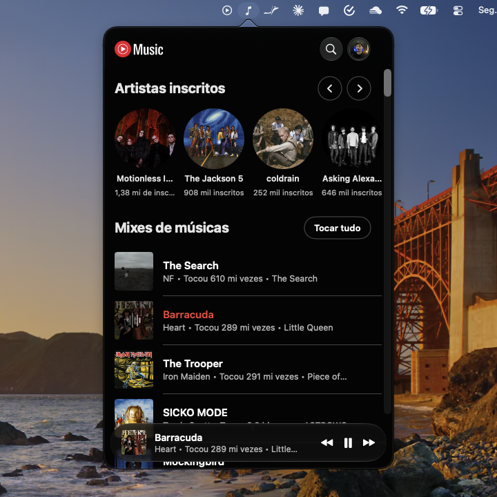
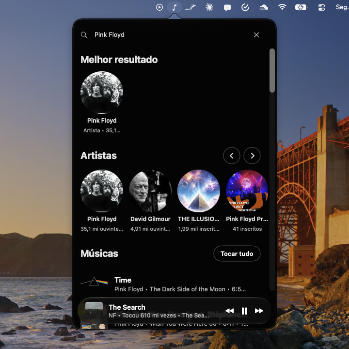
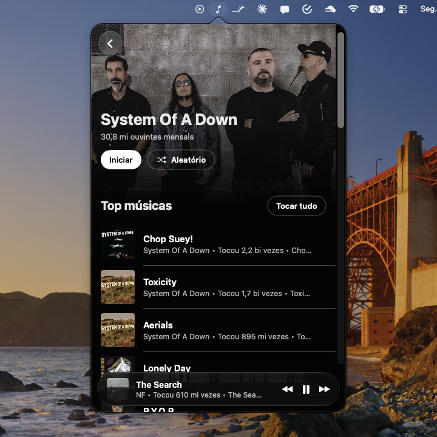
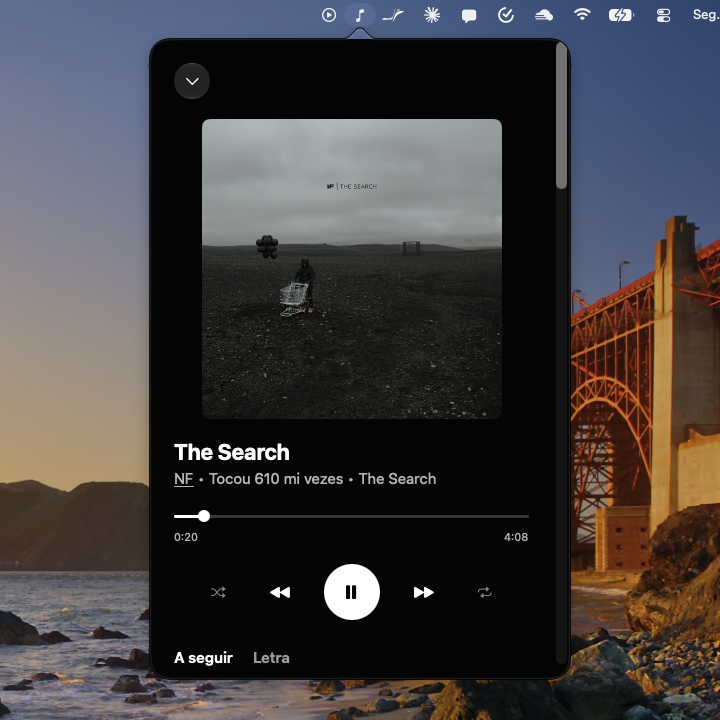

<div align="center">


# YTMusicBar

**YouTube Music in the macOS menu bar, without ads.**


[](LICENSE)
[](https://github.com/CarlosAllberto/ytmusicbar/actions/workflows/build.yml)

[Features](#features) • [Install](#install) • [Usage](#usage) • [How it works](#how-it-works) • [Customize](#customize) • [Limitations](#limitations)

English • <a href="README.pt-BR.md">Português</a>

</div>

YTMusicBar is a menu bar app with a native SwiftUI interface for [YouTube Music](https://music.youtube.com), in a compact popover. Home, search, artists, albums, playlists, your library and lyrics are drawn natively from YouTube Music's internal API. Audio plays through the official player in a hidden `WKWebView`, with ads blocked, and keeps playing when the popover is closed.

Your login is kept between launches.

<p align="center">
  
  
  
  
</p>

> [!NOTE]
> YTMusicBar is an independent project. It is not affiliated with YouTube or Google.

## Features

- **Native interface:** home, artist, album and playlist pages, and your library (saved playlists and albums, liked songs, subscribed artists) in SwiftUI, not a web page. Uses Liquid Glass on macOS 26.
- **Search as you type:** top result plus artists, songs and albums.
- **Lyrics with translation:** the player screen shows the lyrics when YouTube Music has them, and **Traduzir** translates them to Portuguese.
- **Queue:** "Up next" list, shuffle, repeat all or one, and seeking on the progress bar. Artist pages get **Iniciar** and **Aleatório** buttons, and track lists get **Tocar tudo**.
- **No ads:** network rules block ad requests and an injected script skips what gets through in the hidden player.
- **Original track order:** at the end of the queue playback stops instead of drifting to YouTube's automatic radio. Toggle it from the menu.
- **Media keys and Now Playing:** play, pause, next and previous work from the keyboard, and the current track shows in the macOS Now Playing widget.
- **Google sign-in:** sign in from the profile button; without an account, home and search still work.
- **Menu bar only:** right-click menu, global shortcut <kbd>⌥</kbd> <kbd>S</kbd>, launch at login and no Dock icon.

## Install

### Download the prebuilt app

1. Download `YTMusicBar.zip` from the [latest release](https://github.com/CarlosAllberto/ytmusicbar/releases/latest).
2. Unzip it and move `YTMusicBar.app` to `/Applications`.
3. Remove the quarantine flag and open the app:

```bash
xattr -dr com.apple.quarantine /Applications/YTMusicBar.app
```

Releases are built by GitHub Actions for every `v*` tag.

> [!NOTE]
> The app is ad-hoc signed and not notarized by Apple, so macOS blocks it until you remove the quarantine flag.

### Build from source

Requirements:

- macOS 13 or later
- Xcode 15 or later
- [XcodeGen](https://github.com/yonaskolb/XcodeGen)

```bash
brew install xcodegen
git clone https://github.com/CarlosAllberto/ytmusicbar.git
cd ytmusicbar
xcodegen generate
xcodebuild -project YTMusicBar.xcodeproj -scheme YTMusicBar -configuration Release -derivedDataPath build build
open build/Build/Products/Release/YTMusicBar.app
```

The Xcode project is generated from [`project.yml`](project.yml) and is not committed. Run `xcodegen generate` again whenever you add or remove files.

## Usage

| Action | How |
| --- | --- |
| Open or close the popover | Click the icon or press <kbd>⌥</kbd> <kbd>S</kbd> |
| Search | Magnifying glass at the top, then type |
| Open the player, lyrics and queue | Click the mini player at the bottom |
| Sign in | Profile button at the top |
| Library or sign out | Profile picture at the top |
| Open the menu | Right-click the icon |
| Reload the interface | Menu, **Recarregar** (music keeps playing) |
| Keep the original track order | Menu, **Manter ordem das faixas** |
| Launch at login | Menu, **Iniciar com o macOS** |
| Quit | Menu, **Sair** |

> [!NOTE]
> The interface is in Portuguese for now, and the API is called with the Portuguese (Brazil) locale.

## How it works

```
YTMusicBar/
├── App/        SwiftUI entry, interface views, status item, popover and menu
├── Views/      Full-screen player with lyrics and queue
├── Services/   InnerTube API, Google login, player, translation, shortcut, settings
├── WebView/    Ad block rule loading
└── Resources/  Ad script, network rules and assets
```

- **Status item, not `MenuBarExtra`.** `TrayDelegate` owns an `NSStatusItem` and an `NSPopover` hosting the SwiftUI interface, which allows the right-click menu.
- **InnerTube for the interface.** `InnerTube.swift` calls `music.youtube.com/youtubei/v1` (browse, search, next) and turns the JSON into pages, sections and items. When signed in, requests carry your cookies and a `SAPISIDHASH` header.
- **A hidden WebView for audio.** `Player.swift` loads `music.youtube.com/watch?v=ID` in an off-screen `WKWebView`, so YouTube's own player handles the stream. The app keeps its own queue and moves to the next track when the video ends. The page loads only after the block rules compile.
- **Login** happens in a separate window with Google's sign-in page. Cookies live in the default WebKit data store, shared by the player.
- **Translation** uses Google Translate's free public endpoint, without a key.
- **Settings** live in `UserDefaults`.

## Customize

| What | Where |
| --- | --- |
| Ad selectors | `CONFIG` in `Resources/inject-ads.js` |
| API client version and search filters | `Services/InnerTube.swift` |
| Translation target language | `Services/Translate.swift` |
| Global shortcut | `Services/HotKeyService.swift` |

**Network rules.** Every `Resources/rules*.json` file is compiled at launch. To add a list in the Adblock format:

```bash
scripts/convert-filters.py easylist.txt > YTMusicBar/Resources/rules-easylist.json
xcodegen generate
```

The converter handles the basics only: `||domain^`, simple URL patterns and `##selector`.

## Limitations

> [!NOTE]
> InnerTube is an internal, undocumented API. The app uses a fixed client version and fixed search filters, so pages or search can break when YouTube changes it. Ad blocking depends on YouTube's HTML and can break too.

- Translation uses an unofficial endpoint and can stop working at any time.
- Lyrics only show when YouTube Music has them for the track.
- Signing out erases all YouTube website data stored by the app.
- The shortcut is always on and fixed to <kbd>⌥</kbd> <kbd>S</kbd>. If another copy of YTMusicBar is running, only one gets it.
- One account at a time.
