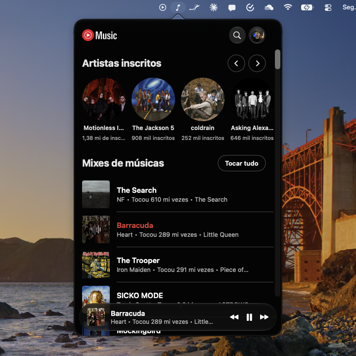
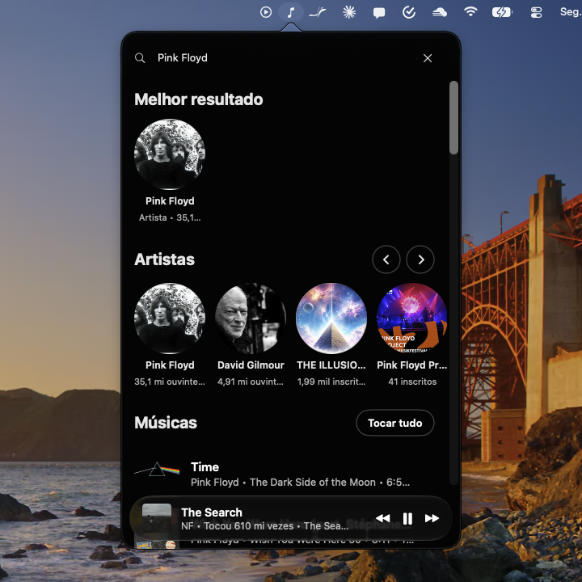
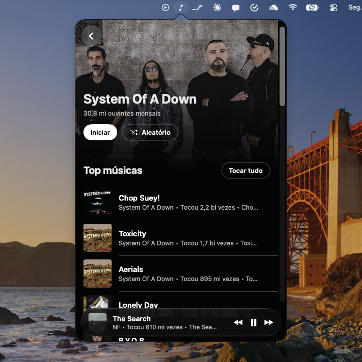
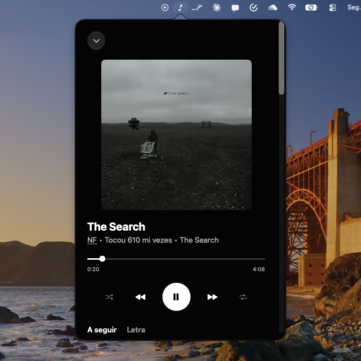

<div align="center">


# YTMusicBar

**YouTube Music na barra de menus do macOS, sem anúncios.**


[](LICENSE)
[](https://github.com/CarlosAllberto/ytmusicbar/actions/workflows/build.yml)

[Recursos](#recursos) • [Instalação](#instalação) • [Uso](#uso) • [Como funciona](#como-funciona) • [Personalizar](#personalizar) • [Limitações](#limitações)

<a href="README.md">English</a> • Português

</div>

O YTMusicBar é um app de barra de menus com interface nativa em SwiftUI para o [YouTube Music](https://music.youtube.com), num popover compacto. Início, busca, artistas, álbuns, playlists, sua biblioteca e letras vêm da API interna do YouTube Music e são desenhados de forma nativa. O áudio toca pelo player oficial numa `WKWebView` escondida, com anúncios bloqueados, e continua com o popover fechado.

Seu login fica salvo entre as execuções.

<p align="center">
  
  
  
  
</p>

> [!NOTE]
> O YTMusicBar é um projeto independente. Não tem relação com o YouTube nem com o Google.

## Recursos

- **Interface nativa:** início, páginas de artista, álbum e playlist e sua biblioteca (playlists e álbuns salvos, músicas curtidas, artistas inscritos) em SwiftUI, não numa página web. Usa Liquid Glass no macOS 26.
- **Busca ao digitar:** melhor resultado, artistas, músicas e álbuns.
- **Letras com tradução:** a tela do player mostra a letra quando o YouTube Music tem, e **Traduzir** passa para o português.
- **Fila:** lista "A seguir", aleatório, repetir todas ou uma, e avanço pela barra de progresso. Páginas de artista ganham **Iniciar** e **Aleatório**, e listas de faixas ganham **Tocar tudo**.
- **Sem anúncios:** regras de rede bloqueiam as requisições de anúncio e um script injetado pula o que passar no player escondido.
- **Ordem original das faixas:** no fim da fila a reprodução para em vez de seguir para a rádio automática do YouTube. Dá para ligar e desligar pelo menu.
- **Teclas de mídia e Now Playing:** play, pause, próxima e anterior funcionam pelo teclado, e a faixa atual aparece no Now Playing do macOS.
- **Login Google:** entre pelo botão de perfil; sem conta, início e busca continuam funcionando.
- **Só na barra de menus:** menu no clique direito, atalho global <kbd>⌥</kbd> <kbd>S</kbd>, iniciar com o macOS e sem ícone no Dock.

## Instalação

### Baixar o app pronto

1. Baixe o `YTMusicBar.zip` da [última release](https://github.com/CarlosAllberto/ytmusicbar/releases/latest).
2. Descompacte e mova o `YTMusicBar.app` para `/Applications`.
3. Remova a quarentena e abra o app:

```bash
xattr -dr com.apple.quarantine /Applications/YTMusicBar.app
```

As releases são geradas pelo GitHub Actions para cada tag `v*`.

> [!NOTE]
> O app tem assinatura ad-hoc e não é notarizado pela Apple, então o macOS o bloqueia até você remover a quarentena.

### Compilar do código-fonte

Requisitos:

- macOS 13 ou superior
- Xcode 15 ou superior
- [XcodeGen](https://github.com/yonaskolb/XcodeGen)

```bash
brew install xcodegen
git clone https://github.com/CarlosAllberto/ytmusicbar.git
cd ytmusicbar
xcodegen generate
xcodebuild -project YTMusicBar.xcodeproj -scheme YTMusicBar -configuration Release -derivedDataPath build build
open build/Build/Products/Release/YTMusicBar.app
```

O projeto Xcode é gerado a partir do [`project.yml`](project.yml) e não vai para o repositório. Rode `xcodegen generate` de novo ao adicionar ou remover arquivos.

## Uso

| Ação | Como |
| --- | --- |
| Abrir ou fechar o popover | Clique no ícone ou tecle <kbd>⌥</kbd> <kbd>S</kbd> |
| Buscar | Lupa no topo, depois digite |
| Abrir o player, a letra e a fila | Clique no mini player no rodapé |
| Entrar | Botão de perfil no topo |
| Biblioteca ou sair da conta | Foto do perfil no topo |
| Abrir o menu | Clique direito no ícone |
| Recarregar a interface | Menu, **Recarregar** (a música continua) |
| Manter a ordem original das faixas | Menu, **Manter ordem das faixas** |
| Iniciar com o macOS | Menu, **Iniciar com o macOS** |
| Sair | Menu, **Sair** |

## Como funciona

```
YTMusicBar/
├── App/        Entrada SwiftUI, views da interface, ícone, popover e menu
├── Views/      Player em tela cheia com letra e fila
├── Services/   API InnerTube, login Google, player, tradução, atalho, configurações
├── WebView/    Carga das regras de bloqueio
└── Resources/  Script de anúncios, regras de rede e imagens
```

- **Status item, não `MenuBarExtra`.** O `TrayDelegate` cuida de um `NSStatusItem` e de um `NSPopover` com a interface SwiftUI, o que permite o menu no clique direito.
- **InnerTube na interface.** O `InnerTube.swift` chama `music.youtube.com/youtubei/v1` (browse, search, next) e transforma o JSON em páginas, seções e itens. Logado, as requisições levam seus cookies e o cabeçalho `SAPISIDHASH`.
- **Uma WebView escondida para o áudio.** O `Player.swift` carrega `music.youtube.com/watch?v=ID` numa `WKWebView` fora da tela, e o player do próprio YouTube cuida do stream. O app mantém a própria fila e passa para a próxima faixa quando o vídeo termina. A página só carrega depois que as regras de bloqueio compilam.
- **Login** acontece numa janela separada com a página de entrada do Google. Os cookies ficam no armazenamento padrão do WebKit, compartilhado com o player.
- **Tradução** usa o endpoint público gratuito do Google Tradutor, sem chave.
- **Configurações** ficam em `UserDefaults`.

## Personalizar

| O quê | Onde |
| --- | --- |
| Seletores de anúncio | `CONFIG` em `Resources/inject-ads.js` |
| Versão do cliente da API e filtros da busca | `Services/InnerTube.swift` |
| Idioma de destino da tradução | `Services/Translate.swift` |
| Atalho global | `Services/HotKeyService.swift` |

**Regras de rede.** Todo arquivo `Resources/rules*.json` é compilado na abertura. Para adicionar uma lista no formato Adblock:

```bash
scripts/convert-filters.py easylist.txt > YTMusicBar/Resources/rules-easylist.json
xcodegen generate
```

O conversor cobre só o básico: `||dominio^`, padrões de URL simples e `##seletor`.

## Limitações

> [!NOTE]
> A InnerTube é uma API interna e sem documentação. O app usa uma versão de cliente e filtros de busca fixos, então páginas ou a busca podem quebrar quando o YouTube mudar. O bloqueio de anúncios depende do HTML do YouTube e também pode quebrar.

- A tradução usa um endpoint não oficial e pode parar a qualquer momento.
- A letra só aparece quando o YouTube Music tem a letra da faixa.
- Sair da conta apaga todos os dados do site do YouTube guardados pelo app.
- O atalho fica sempre ligado e é fixo em <kbd>⌥</kbd> <kbd>S</kbd>. Se outra cópia do YTMusicBar estiver aberta, só uma fica com ele.
- Uma conta por vez.
